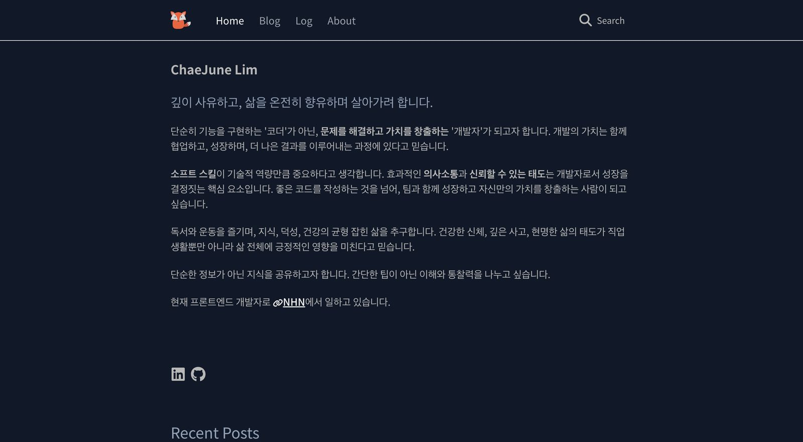
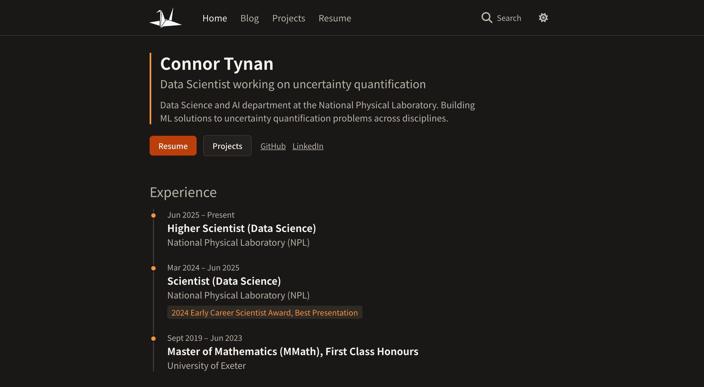

This site is a static Astro build that started life as the [Astro Fox](https://astro.build/themes/details/astro-fox/) theme by ChaeJune Lim. This post walks through how I got from the template to what you see now, in the order I did it. If you want a similar portfolio, you can follow along step by step.

## What you start with

Astro Fox is a clean, dark, developer blog. It ships with a home page, a blog, a short-form log, an about page, Pagefind search and Korean-first typography.



_The original theme, as shown on the [live demo](https://jtfox.dev/)._

And this is where it ended up:



The bones are the same. The fixed header, the narrow reading column and the search button all come from the theme. Most of the work went into deciding what each page is for, then recolouring and reshaping the template around that.

## 1. Set up the project

Clone the theme and install its dependencies. The project uses `pnpm`, which Corepack provides without a global install.

```bash
git clone https://github.com/LimChaeJune/astro-fox.git astro-portfolio
cd astro-portfolio
corepack pnpm install
corepack pnpm run dev
```

The site runs at `http://localhost:4321`. Then set your own domain in `astro.config.mjs`, because the sitemap, RSS feed and social cards all build absolute URLs from it.

```js
export default defineConfig({
  site: "https://cpjt.dev",
  build: { format: "directory" },
  integrations: [mdx(), sitemap(), solidJs(), tailwind(), pagefind()],
});
```

`format: "directory"` writes each page as `page/index.html`, so URLs stay clean on Vercel without rewrite rules.

## 2. Decide what each page is for

The first version had Home, Blog, Log, About, Projects and Resume. Several of these overlapped. About and Resume both listed skills and experience, and the Log duplicated the Blog with shorter posts. I cut it back to four pages, each with one job:

| Page     | Job                                                                  |
| -------- | -------------------------------------------------------------------- |
| Home     | Who I am, a career timeline, skills, featured projects, latest posts |
| Projects | Case studies with results, figures and technical notes               |
| Blog     | Longer writing, including posts converted from notebooks             |
| Resume   | A single PDF download                                                |

Deleting pages turned out to be the most useful design change. Every page that remains has a reason a visitor would open it.

## 3. Recolour with CSS variables

The theme's Tailwind classes point at a small set of CSS custom properties, so a full recolour means editing one file, `src/app/styles/global.css`. I swapped the navy palette for off-white, warm grey and a burnt orange accent.

```css
:root {
  --color-background: #faf8f4;
  --color-surface: #ffffff;
  --color-text: #1f1d1a;
  --color-primary: #bc3f0b;
}

html.dark {
  --color-background: #1a1816;
  --color-surface: #23201d;
  --color-text: #f5f2ec;
  --color-primary: #fb923c;
}
```

Dark mode redefines the same names, so no component needs to know which theme is active. A small script in `public/js/theme.js` reads the saved choice, or falls back to the system setting, and toggles the `dark` class on `<html>`.

The buttons are the one exception. They use their own tokens that stay the same in both modes, white on `#bc3f0b`, which keeps a 5.45:1 contrast ratio either way.

## 4. Keep content in collections

Blog posts and projects are Astro content collections. Each entry is a folder with an `index.md` and its own images, and `src/content/config.ts` validates the frontmatter with Zod. A typo in a date or a missing summary fails the build instead of shipping a broken card.

```text
src/content/blog/my-post/index.md
src/content/projects/sms-spam-detection/index.md
src/content/projects/sms-spam-detection/highlights/model-comparison.svg
```

Projects carry more structured fields than posts, including a one-line `outcome`, up to four `highlights` figures and a list of `technologies`. The project page renders these as a callout, a row of figures and a sidebar, so each case study reads the same way. A small rehype plugin wraps every `##` section on project pages in its own `<section>` for styling.

Posts with `draft: true` show up in local development but are filtered out of production pages and the RSS feed.

## 5. Put the data in one place

Roles, education and skills live in `src/app/static/experience.ts` as typed arrays. The home page timeline reads from that file, so updating a job title means editing one object.

```ts
{
  title: "Higher Scientist (Data Science)",
  organisation: "National Physical Laboratory (NPL)",
  start: new Date("2025-06-01"),
  description: "...",
}
```

Featured projects work the same way. `FEATURED_PROJECTS` in `src/app/static/consts.ts` holds a list of project slugs, and the home page pulls those entries from the collection.

## 6. Publish notebooks as posts

Much of my work starts in Jupyter, so the repo has a converter script. It runs `nbconvert`, moves the output into a content folder, copies generated figures into `public/notebooks/` and adds draft frontmatter.

```bash
corepack pnpm run notebook:convert -- notebooks/source/analysis.ipynb blog analysis
```

The result is a draft post I can edit down before publishing, rather than a raw notebook dump.

## 7. Add search and comments

Pagefind indexes the built HTML, so search works on a fully static site with no server. The theme's default Pagefind UI cleared and rebuilt its results on every keystroke, so I replaced it with a small dialog that calls the Pagefind API directly and keeps the old results on screen until the new ones are ready. The index only exists after `pnpm run build`, so search is empty in dev mode.

Comments use [Giscus](https://giscus.app/), which stores each thread as a GitHub Discussion on the site's repository. There is no database to run, and readers sign in with GitHub.

## 8. Finish the details

A handful of small jobs made the site feel finished:

- a custom social card (`public/og-card.png`) for link previews
- a crane logo and favicons in place of the fox
- a custom 404 page
- `robots.txt` served from a route, so it always points at the real sitemap URL
- RSS items with dates and summaries

## 9. Deploy

The site builds to static files in `dist/` and deploys on Vercel. Every pull request gets a preview URL, so I can check a change on a real phone before merging. Before each merge I run the same checks the build does:

```bash
corepack pnpm run lint
corepack pnpm run build
```

`build` runs `astro check` first, which type-checks the components and validates every content file against its schema.

## What I would do again

Starting from a theme was the right call. Astro Fox gave me a working layout, search and dark mode on day one, so my time went into content and structure instead of plumbing. If you try this yourself, decide what each page is for before you touch the colours. Most of my early changes were undone once I cut the page list down.
